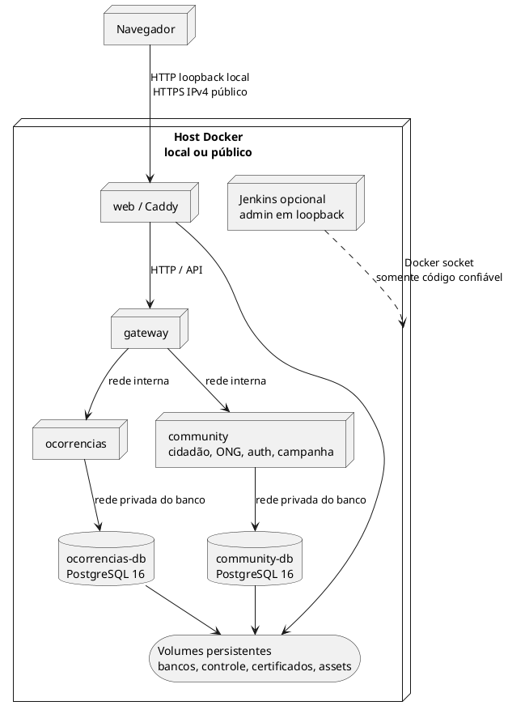

# Implantação Docker atual

Um host Docker executa o gateway, a interface web e os serviços de negócio. `community` reúne cadastro, autenticação e campanhas; `ocorrencias` mantém ocorrências e animais. Cada serviço de negócio possui seu próprio PostgreSQL.

Somente Caddy publica a aplicação. Jenkins é acessado por loopback/túnel SSH; backends e bancos não publicam portas. As redes, imagens e volumes executáveis estão em [`deploy/docker-compose.yml`](../deploy/docker-compose.yml), com complementos cloud e CI no mesmo diretório.